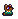
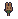

[日本語](README_ja.md) | **English** | [한국어](README_ko.md) | [中文](README_zh.md)

# Sephiria-ExtraCharacters

**From v2.0.0 onward, the mod itself is available exclusively on [Steam Workshop](https://steamcommunity.com/sharedfiles/filedetails/?id=3843151213).**

Adds **six costumes** with unique effects and exclusive artifacts, plus **two weapons**, to Sephiria.
More costumes are planned, with every animation completed before release!

Names, descriptions, and custom UI support Japanese, English, Korean, and Chinese. See the [patch notes](patchlog_en.md) for detailed effects, behavior changes, and fixes.

## Characters

###  My Melody
###  Kirby
###  Tom Nook
###  Sans
###  Crewmate 🆕
###  Dummy-chan

Open **Extra Characters →** in character selection to find the mod's characters.

## Weapons

###  Pocky
###  Buster Sword

## Installation

**From v2.0.0, this is a standalone mod requiring no ModMaker Runtime. The mod itself is distributed through Steam Workshop.**

1. Open this mod's Steam Workshop page and **subscribe**.
2. Once downloaded, enable it in the game's Workshop panel.
3. Restart the game, then open **Extra Characters →** in character selection.

### Updating from an older version

Back up your saves, then **disable the old ModMaker edition of ExtraCharactersMOD before enabling the Workshop edition**. Keep ModMaker Runtime if other AddOns need it.

If you installed a development build in `WorkshopLocal`, disable it and switch to the subscribed edition as well. Multiplayer is unavailable while a `WorkshopLocal` mod is enabled.

## Notes

- **Everyone in multiplayer must install and enable the same version of this mod.**
- Use the game's mod manager to disable it temporarily.
- Sephiria must be obtained separately.

## Acknowledgements

This mod began with **[Sephiria-ModMaker](https://github.com/Xetsumei/Sephiria-ModMaker)** by Xetsumei. Thank you for sharing such a wonderful tool!

## Feedback and Balance

Bug reports, balance feedback, and ideas for new costumes are welcome!

- [GitHub Issues](https://github.com/ao-408/Sephiria-ExtraCharacters/issues)
- Discord DM: `a_o_b`

For bugs, please include your game and mod versions, reproduction steps, and whether you were the host or a guest in multiplayer.

## License

The mod's code and configuration files are released under the [MIT License](LICENSE).
