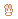
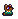
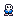
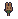

**日本語** | [English](README_en.md) | [한국어](README_ko.md) | [中文](README_zh.md)

# Sephiria-ExtraCharacters

最新バージョン: **v2.0.2**

**v2.0.0から、MOD本体の配布は[Steam Workshop](https://steamcommunity.com/sharedfiles/filedetails/?id=3843151213)のみになりました。**

セフィリアに、独自の効果や専用アーティファクトを持つ**6体のコスチューム**と、**2種類の武器**を追加するMODです。
今後も、すべてのアニメーションを完成させてから新しいコスチュームを追加していきます！

名前・説明・専用UIは、日本語・英語・韓国語・中国語に対応しています。詳しい性能や仕様変更、不具合修正は[パッチログ](patchlog_ja.md)をご確認ください。

## 追加キャラクター

###  マイメロディ
###  カービィ
###  たぬきち
###  サンズ
###  クルーメイト 🆕
###  ダミーちゃん

キャラクター選択画面の **Extra Characters →** から、本MODのキャラクター一覧を開けます。

## 追加武器

###  ポッキー
###  バスターソード

## 導入方法

**v2.0.0からModMaker Runtime不要の独立版になりました。MOD本体はSteam Workshopで配布します。**

1. Steam Workshopで本MODのページを開き、**サブスクライブ**します。
2. ダウンロード後、ゲーム内のWorkshop画面で本MODを有効にします。
3. ゲームを再起動し、キャラクター選択画面の **Extra Characters →** から追加キャラクターを確認します。

### 旧版から更新する場合

更新前にセーブデータをバックアップし、**旧ModMaker版のExtraCharactersMODを無効にしてから**Workshop版を有効にしてください。他のAddOnに必要なModMaker Runtimeは残して構いません。

開発版を `WorkshopLocal` に導入していた場合も、その版を無効にしてWorkshop版へ切り替えてください。`WorkshopLocal`版を有効にした状態ではマルチプレイを利用できません。

## 注意事項

- **マルチプレイでは、全員が同じバージョンの本MODを導入・有効化してください。**
- 一時的に無効にする場合は、ゲームのMOD管理画面を使用してください。
- ゲーム本体は別途必要です。

## 謝辞

本MODは、Xetsumeiさんの **[Sephiria-ModMaker](https://github.com/Xetsumei/Sephiria-ModMaker)** を使って制作を始めました。素晴らしいツールを公開してくださったことに、心より感謝します！

## フィードバック・バランス調整

不具合、強すぎる・弱すぎると感じた点、新しいコスチュームの案など、お気軽にお寄せください！

- [Steam Workshopのバグ報告・ディスカッション](https://steamcommunity.com/sharedfiles/filedetails/discussions/3843151213)
- Discord DM：`a_o_b`

不具合をご報告いただく際は、ゲームとMODのバージョン、再現手順、マルチプレイではホスト／ゲストのどちらかを添えていただけると助かります。

## ライセンス

本MODのコード・設定ファイルは [MIT License](LICENSE) のもとで公開しています。
