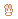
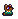
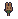

[日本語](README_ja.md) | [English](README_en.md) | **한국어** | [中文](README_zh.md)

# Sephiria-ExtraCharacters

최신 버전: **v2.0.1**

**v2.0.0부터 MOD 본체는 [Steam Workshop](https://steamcommunity.com/sharedfiles/filedetails/?id=3843151213)에서만 배포합니다.**

세피리아에 고유 효과와 전용 아티팩트를 가진 **코스튬 6종**과 **무기 2종**을 추가하는 모드입니다.
앞으로도 모든 애니메이션을 완성한 후 새 코스튬을 추가할 예정입니다!

이름·설명·전용 UI는 일본어·영어·한국어·중국어를 지원합니다. 자세한 성능, 동작 변경 및 수정 사항은 [패치노트](patchlog_ko.md)를 확인해 주세요.

## 추가 캐릭터

###  마이멜로디
###  커비
###  너굴
###  샌즈
###  크루원 🆕
###  더미짱

캐릭터 선택 화면의 **Extra Characters →**에서 MOD 캐릭터 목록을 엽니다.

## 추가 무기

###  포키
###  버스터 소드

## 설치 방법

**v2.0.0부터 ModMaker Runtime이 필요 없는 독립판이며, MOD 본체는 Steam Workshop에서 배포합니다.**

1. 이 MOD의 Steam Workshop 페이지에서 **구독**합니다.
2. 다운로드 후 게임의 Workshop 화면에서 MOD를 활성화합니다.
3. 게임을 재시작한 뒤 캐릭터 선택 화면의 **Extra Characters →**에서 확인합니다.

### 구 버전에서 업데이트

세이브를 백업하고 **ModMaker의 구 ExtraCharactersMOD를 끈 뒤 Workshop판을 켜 주세요.** 다른 AddOn에 필요한 ModMaker Runtime은 남겨 두어도 됩니다.

개발판을 `WorkshopLocal`에 설치했다면 그 판도 끄고 구독판으로 전환해 주세요. `WorkshopLocal` MOD가 활성화되어 있으면 멀티플레이를 이용할 수 없습니다.

## 주의사항

- **멀티플레이에서는 전원이 같은 버전의 MOD를 설치하고 활성화해야 합니다.**
- 잠시 끄려면 게임의 MOD 관리 화면을 이용해 주세요.
- 게임 본편은 별도로 필요합니다.

## 감사의 말

이 모드는 Xetsumei님의 **[Sephiria-ModMaker](https://github.com/Xetsumei/Sephiria-ModMaker)**로 제작을 시작했습니다. 훌륭한 도구를 공개해 주셔서 진심으로 감사드립니다!

## 피드백 · 밸런스 조정

버그, 너무 강하거나 약한 점, 새 코스튬 아이디어 등 편하게 알려 주세요!

- [GitHub Issues](https://github.com/ao-408/Sephiria-ExtraCharacters/issues)
- Discord DM: `a_o_b`

버그 제보 시 게임·MOD 버전, 재현 순서, 멀티플레이에서는 호스트·게스트 여부를 함께 알려 주시면 도움이 됩니다.

## 라이선스

이 MOD의 코드와 설정 파일은 [MIT License](LICENSE)에 따라 공개됩니다.
