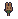

[日本語](README_ja.md) | [English](README_en.md) | [한국어](README_ko.md) | **中文**

# Sephiria-ExtraCharacters

最新版本: **v2.0.1**

**从v2.0.0起，MOD本体仅通过[Steam创意工坊](https://steamcommunity.com/sharedfiles/filedetails/?id=3843151213)发布。**

为塞菲莉娅添加拥有独特效果和专属神器的 **6套服装**与 **2种武器**的MOD。
今后也会在完成全部动画后，再追加新服装！

名称、说明及专用界面支持日语、英语、韩语和中文。详细效果、机制变更与修复内容请查看[更新日志](patchlog_zh.md)。

## 新增角色

###  美乐蒂
###  卡比
###  狸克
###  Sans
###  船员 🆕
###  假人酱

通过角色选择界面的 **Extra Characters →** 打开本MOD角色列表。

## 新增武器

###  百奇
###  破坏剑

## 安装方法

**从v2.0.0起，本MOD为无需ModMaker Runtime的独立版，MOD本体通过Steam Workshop发布。**

1. 在本MOD的Steam Workshop页面点击 **订阅**。
2. 下载完成后，在游戏的Workshop界面启用MOD。
3. 重启游戏，通过角色选择界面的 **Extra Characters →** 确认新增角色。

### 从旧版更新

备份存档，**先停用ModMaker中的旧ExtraCharactersMOD，再启用Workshop版**。其他AddOn需要的ModMaker Runtime可以保留。

如果安装过 `WorkshopLocal` 开发版，也请停用并改用订阅版。启用 `WorkshopLocal` MOD时无法进行多人游戏。

## 注意事项

- **多人游戏时，所有人都必须安装并启用同一版本的本MOD。**
- 暂时停用请使用游戏MOD管理界面。
- 游戏本体需另行获取。

## 致谢

本MOD最初使用Xetsumei开发的 **[Sephiria-ModMaker](https://github.com/Xetsumei/Sephiria-ModMaker)** 制作。衷心感谢他公开这款优秀的工具！

## 反馈与平衡调整

Bug、过强或过弱的体验、新服装建议，都欢迎反馈！

- [GitHub Issues](https://github.com/ao-408/Sephiria-ExtraCharacters/issues)
- Discord DM：`a_o_b`

报告Bug时，请附上游戏与MOD版本、复现步骤，以及多人游戏时是房主还是非房主。

## 许可证

本MOD的代码与配置文件以 [MIT License](LICENSE) 发布。
