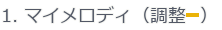
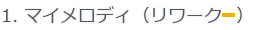

**日本語** | [English](patchlog_en.md) | [한국어](patchlog_ko.md) | [中文](patchlog_zh.md)

# パッチノート

**v2.0.0から、MOD本体の配布は[Steam Workshop](https://steamcommunity.com/sharedfiles/filedetails/?id=3843151213)のみになりました。** Nexus Mods・GitHubでは紹介や更新情報をご案内します。

## v2.0.1

### 不具合修正

- **クルーメイト**：会議外の与ダメージ−60%と投票・追放ダメージの例外の説明を、中央の紹介文から下の効果欄へ移動しました。

### その他

- **クルーメイト**：中央の紹介文に「……今、誰かベントに入らなかった？」を追加しました。英語・韓国語・中国語にも対応しています。

## v2.0.0

新コスチューム「クルーメイト」が参戦！
さらに、本MOD初の武器「ポッキー」と「バスターソード」を追加しました！
専用アニメーションの追加や、バランス調整も行っています。

**今回からModMaker Runtime不要の独立版となり、MOD本体の配布先をSteam Workshopへ移します。** 更新前に[導入方法](README_ja.md#導入方法)をご確認ください。

### 新キャラクター

#### 1. クルーメイト

**ステータス**：攻撃速度+20% ／ 会議外の与ダメージ−60%

**初期アイテム**：緊急会議ボタン

宇宙船の仕事をほっぽり出して、クルーメイトが塔にやってきた！

ボタンを押すと、**10秒間の緊急会議**が始まります。参加者は無敵！……ですが、会議中に暴力はいけないので、通常の与ダメージは99%減ってしまいます。

会議中に殴った敵には1発ごとに1票が入り、終了時に**一番票を集めた敵1体を追放**します。最多票が同数なら、誰も追放されません。票数の上限はありません。

敵の中には、こっそり他の敵を襲う**インポスター**が紛れ込んでいます。インポスターだけが残ると、正体を現して大暴れ！

- **インポスターを追放できたら大手柄！** 残りの敵にも票数に応じたダメージを与えます。ボス戦・中ボス戦以外では、ボタンの再使用待機時間を80%短縮します。
- **無実の敵を追放してしまったら……** 参加者全員が3.5秒間気絶します。
- **ボス・中ボス**は追放しても倒れず、HPを最低1残します。その代わり、票数に応じたダメージを与え、再使用待機時間を50%短縮します。

追放ダメージは、最高属性ダメージとアーティファクトダメージ増加で伸びます。
会議終了後には**チーム共有の待ち時間9秒**があり、ボタンを交代で連打して会議を続けることはできません。
また、ボタンはバッグの外周2マス以内では使えません。船のボタンは真ん中にあるものですからね。

会議外の火力は控えめですが、**投票・追放ダメージは会議外の与ダメージ−60%の対象外**です。
殴って倒すより、会議で倒す。それが彼の戦い方です！

マルチプレイでは、緊急会議ボタンを持つプレイヤーが同じ会議に参加します。

### 新武器

#### 1. ポッキー

**入手方法**：金床で「神珍鉄棍」を強化（3段階目の棒）

あのお菓子が、ついに武器になりました！

- **特殊攻撃は「食べる」！** 残りを食べ切ってHPを回復し、攻撃速度と通常攻撃ダメージが上がります。長いまま食べるほど効果が大きく、満タンなら最大HPの3.5%回復と、8秒間の攻撃速度+25%・通常攻撃ダメージ+20%を得られます。
- 通常攻撃・ダッシュ攻撃を12回当てるごとに、満タン → 3/4 → 1/2 → 1/4 → 空と短くなります。短くなるほど攻撃範囲が狭くなり、空の状態で食べるバフもなければ通常攻撃ダメージ−30%になります。
- 近接攻撃範囲は、長さ100%／75%／50%／25%／0%の順に **+35%／+18%／0%／−18%／−35%** です。
- 空になった時は、ストックがあれば1本使って新しいポッキーへ持ち替えます。

替えのポッキーは、商人が売る**ポッキー箱**で補充できます。**34本入り、220リーフ固定**。交渉力に関係なく同じ値段で、ポッキー所持者だけが購入できます。

ポッキーへ強化した時には、お祝いに**箱を1個**もらえます。訓練場での獲得・強化でも同様です。
箱には専用の開封モーションも用意しました。さすがに箱ごとは食べません！

#### 2. バスターソード

**入手方法**：金床で「過敏性」を強化（3段階目の大剣）

大きな剣には、大きな見せ場を！
攻撃や被ダメージでリミットゲージをため、4種類のリミット技を使い分ける大剣です。

- ゲージは100ごとに1段階、最大4段階。攻撃命中では与ダメージ×0.1、1ヒットにつき最大25たまります。
- **特殊攻撃を長押しすると、毎秒45ずつチャージ**します。チャージ中は移動できませんが、戦闘外でもためられます。
- 1段階以上ある時に**特殊攻撃を短く押すと、現在の段階のリミット技を発動**。ゲージをすべて消費し、発動中は無敵になります。

| 段階 | リミット技 | 特徴 |
|---|---|---|
| 1 | 凶斬り | 近くの敵へ踏み込み、気絶を与える3連撃。 |
| 2 | 破晄撃 | 前方へ衝撃波を放ち、着弾地点の周囲にもダメージ。 |
| 3 | 画竜点睛 | 竜巻で周りの敵を巻き上げ、最後に吹き飛ばす。 |
| 4 | 超究武神覇斬 | 瞬間移動しながら15連撃し、最後に範囲攻撃。すべてクリティカル！ |

ゲージはマナゲージの右隣に表示され、変化した時はキャラクターの下にも表示されます。
詳しい効果と威力は、ゲーム内の各リミット技のツールチップをご確認ください。

近接攻撃範囲は+15%です。

### アニメーション・操作

- サンズとダミーちゃんに専用の攻撃アニメーションを追加し、一部の不自然な動きを修正しました。
- **すべてのコスチュームに、すべてのアニメーションがそろいました！** 今後も完成してからリリースします。
- キャラクター選択画面に **Extra Characters →** を追加し、本MODのキャラクター一覧へ切り替えられるようにしました。MODキャラクターを選択中は、MOD側の一覧から始まります。

### バランス調整

#### 

**初期アイテム変更**：割れたサファイアを削除

**記載漏れの訂正**：ダッシュ中の無敵時間ボーナス+0.2秒 → +0.3秒

前回、割れたサファイアの追加と無敵時間ボーナスの変更を、パッチノートに書き忘れていました。申し訳ありません！
今回、その強力な初期アーティファクトとはお別れしますが、無敵時間ボーナス+0.3秒はそのまま残します。

#### 

**ステータス変更**：フルーツ串の上限+8 → +6 ／ バッグ枠−3を追加

食いしん坊なのは相変わらずですが、持ち運べる量には少し悩んでもらいます。

**能力星**

- コピー中は能力星自身の基本説明を非表示にし、コピー元の効果文を表示します。
- コピーした能力の効果レベルは、能力星本体のレベルで決まります（コピーした能力の最大レベルまで）。コピー元のレベルには左右されません。
- **コピー元の配置条件や武器の制限もコピー**し、能力星の位置・装備で判定します。
- 突破のコンパスや巨大望遠鏡など、バッグ内の位置を使う能力は、**コピー元と能力星それぞれの位置で効果を発揮**します。
- 能力星にカーソルを合わせると、下のコピー対象をピンクの枠で示します。

#### 

**ステータス変更**：防御+20を追加

彼女はそのプレイ難易度に反して他のキャラクターと比べて貰えるステータスが強くありませんでした。
そこで、彼女に打たれ強いという個性を与えるため、防御力を付与するようにしました。

### 不具合修正

- **能力星**：移動元にレベル表示が残る問題、コピー元を外した後や置き直した時の最大レベル表示の不具合を修正しました。
- **能力星**：コピーした効果文の「−」や箇条書きが欠ける問題を修正しました。
- **能力星**：位置に関する能力の更新・解除を修正しました。コピーを動かしても、元のアーティファクトの効果は維持されます。
- **能力星**：ツールチップの効果文を毎フレーム生成する処理や、バッグ全体の追加再計算をなくし、処理負荷を削減しました。
- **キャラクター選択・プリセット**：追加キャラクターが表示されない、プリセットで「？」になる問題を修正しました。
- **翻訳**：名前だけ翻訳されている場合に、ほかの説明が表示されない問題を修正しました。

- **ただのケチャップ**：回避成功時の「0.5秒間無敵」「MP10%回復」が発動していなかった問題を修正しました。
- **テント／マイホーム**：ゲスト側の増築表示、リーフ不足でも施設を使えてしまう場合がある問題、バッグ拡張を購入できる問題を修正しました。
- **説明文**：メロディバフの持続時間など、実際の効果と異なる表記や説明不足を修正しました。
- **更新通知**：通知が何度も表示されることがある問題などを修正しました。

## v1.2.0

新コスチューム「たぬきち」を追加し、既存コスチュームの調整を行いました。

### 新キャラクター

#### 1. たぬきち（新規追加）

**ステータス**：リーフドロップ +50000%

**初期アイテム**：テント

商売上手なたぬき、たぬきちが参戦！

彼はリーフ集めの達人で、リーフドロップがなんと +50000% されます！
これなら大金持ち間違いなし……と言いたいところですが、そう甘くはありません。

彼は専用アーティファクト「テント」を持ってゲームを開始します。
このアーティファクトを持っている間、**リーフの消費量が500倍**になります！（ショップの買値などが対象で、売値は変わりません）
さらに、**バッグは2×2、サブバッグとポーションは1枠に固定**されてしまいます。テント暮らしは狭いのです。

でも安心してください！
所持リーフが増築費用に達すると、自動でローンを支払って家が**増築**されます。
増築するたびにバッグ・サブバッグ・ポーションの枠が広がり、拾ったリーフの獲得量も増え、さらに報酬ももらえます！

| アーティファクト | バッグ | サブバッグ | ポーション | 拾ったリーフ | 次の増築費用 | 増築の報酬 |
|---|---|---|---|---|---|---|
| テント | 2×2 | 1 | 1 | ×1 | 98,000 | 再生のポーション ×1 |
| マイホーム(1段階目) | 3×3 | 2 | 2 | ×1.22 | 198,000 | 大きな再生のポーション ×1 |
| マイホーム(2段階目) | 4×4 | 3 | 3 | ×1.54 | 348,000 | サイコロ ×2 |
| マイホーム(3段階目) | 5×5 | 4 | 4 | ×1.90 | 548,000 | ランダムな一般石板 ×1 |
| マイホーム(4段階目) | 6×6 | 5 | 5 | ×2.15 | 758,000 | ランダムな高級石板 ×1 |
| マイホーム(5段階目) | 7×7 | 6 | 6 | ×3.00 | 1,248,000 | ランダムな希少石板 ×1 |
| マイホーム(6段階目) | 8×8 | 7 | 7 | ×5.20 | 2,498,000 | 特別な効果 |
| マイホーム(7段階目) | 9×9 | 8 | 8 | ×6 | — | — |

最後まで増築してローンを完済すると、「マイホーム(7段階目)」の特別な効果が解禁されます。
バッグ内のマイホームを**右クリック**すると、リーフを支払って**レベルアップ時と同じ報酬選択**を1回得られます！
費用は1回目が 1,000,000 リーフで、使用するたびに 1,000,000 ずつ上がります。

なお、このアーティファクトは**無効化できません**。レベルがマイナスになっても、無効化マスに置いても、効果は止まりません。ローンからは逃げられないのです。

今回は最初から専用の攻撃モーションも用意しています！

### バランス調整

#### 

**ステータス変更**：治癒の呪い +70% → +60%

**アーティファクト「キュートノーツ」**：
- メロディバフの持続時間 2秒 → 1.5秒

治癒の呪いを少し緩めて、回復しやすくしました。
その代わり、メロディバフが切れるまでの時間が短くなったので、スタックを維持するにはこれまでより手数が必要になります。

#### 

**アーティファクト「ただのケチャップ」**：
- 各属性ダメージ -14 → -12
- 追加：回避成功時、0.5秒間無敵になり、MPを10%回復
- 追加：落下ダメージ無効

各属性ダメージのマイナスを緩めて、火力を少し底上げしました。

さらに、回避に成功すると短時間無敵になり、MPも回復するようになりました！
避ければ避けるほど有利になる、彼らしい戦い方ができます。

また、HPが1しかない彼は、奈落に落ちただけでゲームオーバーになってしまっていました。
奈落による事故を無くすため、落下ダメージは受けないようにしています。

#### 

**ステータス変更**：交渉力 -60 → -80

**アーティファクト「能力星」**：
- フレーバーテキストを追加

能力星があまりにも強力だったため、交渉力をさらに下げてバランスを取りました。
お買い物はますます苦手になってしまいましたが、コピー能力そのものはそのままです。

### その他

- **ModMaker Runtimeをv2.5.35に更新**：本バージョンに合わせて、ModMaker Runtimeをv2.5.35に更新しました。お使いのRuntimeがv2.5.35より古い場合、正しく動作しない可能性があります。その場合はRuntime同梱版（`-withRuntime.zip`）をダウンロードして導入してください。
- **マルチプレイについて**：「たぬきち」は、マルチプレイでホスト以外のプレイヤーが使用した場合の動作が未検証です。不具合を見つけた際はご報告いただけると助かります。

## v1.1.0

新コスチューム「カービィ」を追加し、既存コスチュームの調整と新機能の追加を行いました。

### 新キャラクター

#### 1. カービィ（新規追加）

**ステータス**：フルーツ串の上限 +8 ／ 交渉力 -60

**初期アイテム**：能力星

ピンクの悪魔ことカービィが参戦！

食いしん坊な彼はフルーツもいっぱい食べたいようで、フルーツ串の上限が8も上がります！

しかし、彼は会話下手（というか会話不可？）なので交渉力は大幅に低下します……トホホ。

また、彼は強力なアーティファクト「能力星」を持ってゲームを開始できます！
このアーティファクトは彼の代名詞とも言えるコピー能力を再現したものです！

能力星は、下に配置されているアーティファクトの能力をコピーすることができます！
一部のアーティファクトはコピーしても意味がなくなってしまいますが、ほとんどのアーティファクトで効果を発揮できます。
例えば、モグラ隊長を2匹に増やしたり、ジョウロでさらに追加の魔導書を詠唱できたりなど、様々な活用法があります！

### バランス調整

#### 

**ステータス変更**：治癒の呪い +70% を追加

**アーティファクト「キュートノーツ」をリワーク**：
- バフ獲得時にHPを固定値で回復する効果を削除
- メロディバフ1スタックにつきHP再生+1を得る効果を追加
- 攻撃モーションを追加

彼女のアーティファクトは意図した挙動をしていなかったため、リワークすることにしました！

メロディバフ1スタックごとにHP再生1を獲得するようになったため、最大でHP再生88にまで到達可能な、非常に強力なHP再生手段になりました！

しかし、そのままではあまりにも強力すぎると考え、大きめの治癒の呪いを追加してバランスを調整しています。

彼女をプレイしていて、何か物足りなさを感じたことはありませんか？
そう、攻撃モーションです！

これまで追加したキャラクターには専用の攻撃モーションが用意されていませんでしたが、今回はマイメロディに攻撃モーションを追加しました！

他の既存キャラクターの攻撃モーションについては、今後のパッチをお楽しみに。

#### 

**ステータス変更**：ダッシュ回復速度 +150% → +220%

彼女をプレイするのはあまりにも難しかったため、少し手を加えることにしました。
（かかしなのに、なぜこんなにダッシュできるのでしょうか……？）

### その他

- **更新通知機能を追加**：ゲーム起動時に本MODの新しいバージョンが公開されている場合、通知が表示されるようになりました！これで新パッチを見逃す心配はありません！
- **ModMaker Runtimeをv2.5.32に更新**：本バージョンに合わせて、ModMaker Runtimeをv2.5.32に更新しました。お使いのRuntimeがv2.5.32でない場合、正しく動作しない可能性があります。その場合はRuntime同梱版（`-withRuntime.zip`）をダウンロードして導入してください。

## v1.0.0

コスチューム追加。以下の3つの新しいコスチュームを追加しました。

### 1. マイメロディ

**ステータス**：幸運 +18 ／ クリティカル確率 -120%
**初期アイテム**：キュートノーツ

かわいいずきんを被ったマイメロディが参戦！

彼女は幸運を18も得ることができ、さらに強力なオリジナルアーティファクト「キュートノーツ」を所持した状態でゲームを開始できます！

このアーティファクトは攻撃時に確率で「メロディバフ」を獲得でき、メロディバフ1スタックにつき攻撃速度が1%上昇します。
このバフは88スタックまで獲得できるため、このアーティファクト一つで攻撃速度を最大88%まで得ることができます！
さらに、メロディバフ獲得時にはHPを固定値で回復するおまけつきです。

しかし、この強力なアーティファクトを所持できる代償として、クリティカル率が-120%され、クリティカルを出すことがほぼ不可能になってしまいます。

### 2. サンズ

**ステータス**：HPが1に固定 ／ 強靭さ -9999999 ／ 回避 +100 ／ ダッシュ中の無敵時間ボーナス +0.2秒
**初期アイテム**：雷の裁き ／ ただのケチャップ

ジョークとケチャップをこよなく愛するスケルトン、サンズが参戦！

原作での彼のステータス（HP1、AT1、DF1）をセフィリアでも再現しました。
ステータスでHPは1に固定され、オリジナルアーティファクト「ただのケチャップ」によってATとDF（すべての属性ダメージと防御力）が1に固定されます。

でも安心してください！
1を超えた属性ダメージはすべて固定ダメージに変換されるため、どの属性ダメージを上げても火力アップにつながります（ただし、すべての属性ダメージの初期値を下げてバランスを調整しています）。
防御力の超過分は回避に変換されます。

また、回避やダッシュ中の無敵時間ボーナスもステータスとして獲得できます。
これは、原作で彼が攻撃を確実に22回避けてみせる動きに近づけるための調整です。

原作同様、彼は最初から必殺技「雷の裁き」を所持した状態でスタートできます！
「いつも思ってたんだ。なんで誰も最初から必殺技を使わないんだろうってな」。

強靭さが-9999999されている理由は……彼の最期をご存じなら、説明は不要でしょう。

### 3. ダミーちゃん

**ステータス**：移動速度 -100% ／ ダッシュ回復速度 +150%

殴られるだけなんてもうこりごりだ！セフィリアのダミー人形ことダミーちゃんが参戦！

彼女は移動速度-100%の状態でスタートするため、自力で動くことができません（ダミーが動いたら変ですもんね）。

しかし移動手段がないとクリアどころか、ゲームを開始することすらできません！
そこで、彼女の唯一の移動手段であるダッシュの回復速度が大幅に上昇した状態でスタートします（ダミーがダッシュするなんておかしな話ですが）。

### その他

現時点では新コスチュームに専用の攻撃モーションは用意されていません。今後のパッチで追加予定ですので、お楽しみに！
